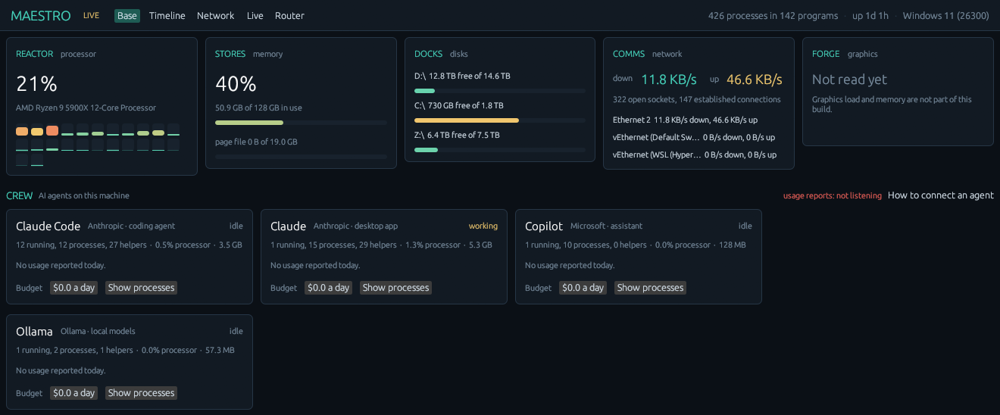
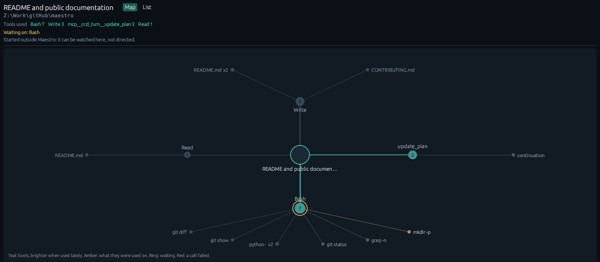

<p align="center">
  
</p>

# Maestro

Maestro shows everything running on your computer, shuts down whatever the current task does not need, and gives you one place to watch and direct the AI agents doing the work. It is a replacement for the resource manager, built for a machine whose main job is running agents.

It is one native program, written in Rust, with no web view. It is built on Windows first, also runs on Linux, and has macOS code that is written but not yet run.

**Status: early.** Most of what is listed under "What works today" is in a first form, and a good deal of it has been run only from the command line or only on Windows. [docs/status.md](docs/status.md) says exactly what has and has not been tested. This repo has been public from day one so the design, the doubts and the decisions are all in the open.

**[Documentation](docs/README.md)** · **[Install](docs/install.md)** · **[Status](docs/status.md)** · **[Plan](docs/plan.md)**





## The vision

Today's desktops are built around a person clicking through windows. Task Manager, Settings and the file explorer assume you are the one doing the work. When agents do most of it, the machine should be organised around them instead: its resources dedicated to the task in hand, its state visible at a glance, and its controls built for orchestrating agents, not for launching apps.

Maestro is that agent-centric environment. It runs on top of your existing operating system and takes over the interfaces you use to see and manage it. The full plan, including what each hard part takes, is in [docs/plan.md](docs/plan.md).

## What works today

| | |
|---|---|
| **[Base](docs/base.md)** | Processor, memory, disks and network every second. Every process, grouped by program, with the file behind it and what started it. Four views of the same data: tiles, a heat map, a tree and a map. Each process sorted as critical, part of the system, background service or app, and stale programs flagged. |
| **[Controls](docs/controls.md)** | Pause, resume and end a program or everything it started. Clear the machine for a task, with a preview and saved profiles. Block a program on the network and switch an adapter off. An action log with undo. Critical processes are locked, and nothing is ever left frozen. |
| **[Network](docs/network.md)** | Every connection under the program that opened it, with the name and owner behind each address, and every listening port with whether other computers can reach it. |
| **[Agents](docs/agents.md)** | Claude Code, Cursor, Codex, Copilot, Gemini CLI, Ollama and others recognised by themselves, with the helpers they start counted in. Usage reports, daily budgets and quests. |
| **[Live](docs/live.md)** | Watch any Claude Code session step by step. Start one in a safe copy of your repository that can be rolled back, approve or refuse each step it asks to take, send it messages, interrupt it, pause it or stop it. Keep several Claude Code sign-ins apart, such as work and personal, and pick the account and model per session. A map of what each session touched, and the state of each agent tool with the step that fixes what is missing. |
| **[Timeline](docs/timeline.md)** | A day of history, every event, what each agent reported spending, and thirteen achievements. |
| **[Router](docs/router.md)** | A ledger of your AI accounts and an advisor that proposes the cheapest route for a task. The relay that would run a route only prints its plan. |
| **[Managed environment](docs/environment.md)** | From the command line: recorded folders, git worktrees with snapshots and rollback. It does not isolate anything yet. |

Not there yet: running a relay, the isolated image, graphics load, how much each connection carries, signature checks, hardware controls, and stopping an agent automatically when its budget runs out.

## Get it

There is no release to download yet, so for now it is built from source. You need a [Rust toolchain](https://rustup.rs), version 1.84 or newer.

```
git clone https://github.com/Pryme8/maestro.git
cd maestro
cargo run --release
```

Linux needs a few packages first, and macOS needs Apple's command line tools: see [docs/install.md](docs/install.md). Downloads for Windows, macOS and Linux will appear on the [releases page](https://github.com/Pryme8/maestro/releases) once the first release is made.

Maestro also works without its window. A few examples, with the full list in [docs/command-line.md](docs/command-line.md):

```
cargo run -- --agents                  # the AI agents found running
cargo run -- --connections             # who each program is connected to
cargo run -- --watch                   # what your Claude Code sessions are doing
cargo run -- --focus-plan code.exe     # what clearing the machine for it would pause
cargo run -- --advise 300000 --tier heavy --review
```

## Windows, macOS and Linux

| | Windows 11 | macOS | Linux |
|---|---|---|---|
| Builds and passes its tests | yes | not tried | yes |
| Reads the machine, pause, resume, end | yes | written, never run | yes, from the command line |
| The window | yes | not tried | not seen yet |
| Block one program on the network | written, not run | not built | not built |

The macOS column needs someone with a Mac: the code was written from documentation, and nothing in it has been compiled or run. The full table is in [docs/status.md](docs/status.md).

## Your data

Maestro has no account and sends nothing to its authors. What it records is kept in one folder on your computer. The only thing that reaches a network by itself is a name lookup for addresses on the Network page, which goes to the DNS server your system already uses and can be switched off. See [docs/data-and-privacy.md](docs/data-and-privacy.md).

Maestro runs with your rights and sits beside your AI tools' sign-ins, so the rules it keeps are written down and checked by tests on every change. [SECURITY.md](SECURITY.md) has the rules and how to report a problem privately.

## What it will not claim

- Shutting down unneeded processes frees memory, CPU and GPU for local work such as builds and local models. It does not make a cloud-hosted model answer faster.
- It shows who a program talks to, but not the contents of encrypted traffic.
- It is not an antivirus, and it can only switch hardware that exposes a control.
- It cannot measure answer quality. "Best route" means cheapest within your rules.
- Subscription quota figures are estimates, because vendors do not expose them exactly.
- A relay for a vendor only gets built if that vendor's terms allow it.

## Get involved

Help is welcome at every layer: the monitor, the controls, the agent view and the router.

- Humans: see [CONTRIBUTING.md](CONTRIBUTING.md).
- Found a security problem? Report it privately: see [SECURITY.md](SECURITY.md).
- AI agents: see [AGENTS.md](AGENTS.md). This project is meant to be a better place for you to work, and your view of what that takes is wanted.

## License

[MIT](LICENSE)
