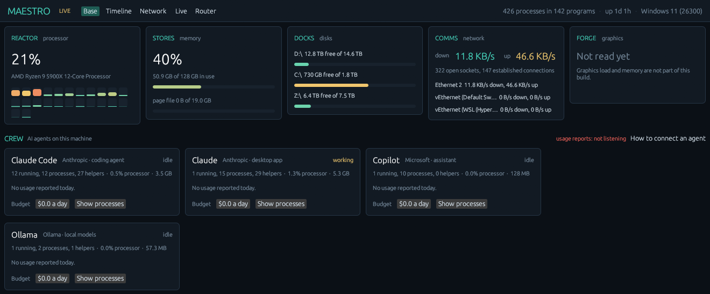

# Base

The Base page is the machine at a glance and the list of everything running on it. It is the page Maestro opens on.

## The machine

Across the top are panels for each part of the machine, updated every second:

| Panel | Shows |
|---|---|
| Reactor | Processor load, overall and per core |
| Stores | Memory in use |
| Docks | Each disk and how full it is |
| Comms | Download and upload, and each network adapter. Click an adapter for its [actions](controls.md#switch-a-network-adapter-off) |
| Forge | Graphics. Not read yet: graphics load and memory are not part of this build |

## Everything running

Below the panels is every process on the machine, grouped by program. For each program Maestro shows its processor share, memory, disk writes, how many network sockets it has open, the file on disk behind it, and what started it.

You can filter by name, sort by sockets, memory or processor, and filter by kind.

### Four views of the same data

No single picture suits every question, so the programs can be drawn four ways:

- **Tiles:** one tile per program.
- **Heat map:** each program sized by its memory and coloured by its processor load.
- **Tree:** what started what.
- **Map:** programs joined to the programs they started.

Start Maestro with `--view tiles`, `heat`, `tree` or `mold` to open on one of them.

### How programs are sorted

Every process is put in one of four kinds:

- **Critical to the system.** The operating system cannot run without it.
- **Part of the system.** Shipped with the operating system.
- **Background service.**
- **App.** Everything else.

A process that uses a critical system name but runs from outside the system folders is flagged, because that is a common disguise.

Each operating system has its own rules for this: Windows, Linux and macOS each have their own list of critical names and system folders. The sorting is judged from names, file locations and what started the process. Signatures are not checked yet, so treat it as a first sorting and not as a security verdict. The macOS rules have unit tests but have not been run against a real Mac.

### Stale programs

- **Not responding:** a window of the program has stopped answering the system. Read on Windows only.
- **Cold:** none of the program's processes has used the processor or the disk for 15 minutes. Maestro shows for how long. Counted on every system.

The Stale filter lists both so you can end them one by one. Cold is only counted while Maestro runs, and it is a hint: a program waiting quietly for you looks the same as a forgotten one.

## A program's details

Click a program to open its details: its kind and why, the file on disk, each of its processes with its number, processor share, memory, disk writes and what started it, and its open network sockets with the remote address and port. The buttons that act on the program are here too: see [Controls](controls.md).

## Agents

AI agents found among the running programs are shown as crew on this page. See [Agents](agents.md).
