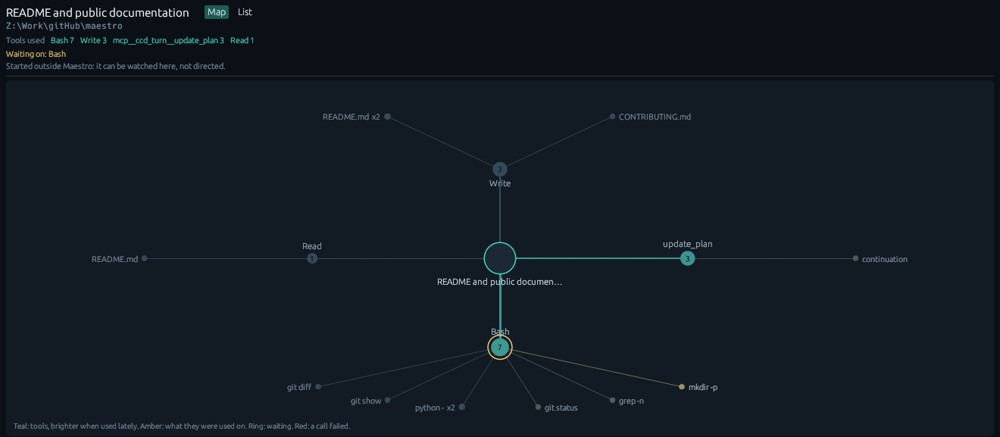

# Live

The Live page shows what an agent is doing as it does it, and lets you start a session and direct it. Today it works with Claude Code only.

## Watch any Claude Code session

Every Claude Code session active in the last hour is listed, wherever it was started: a terminal, an editor or the desktop app. Pick one to see its steps as they happen:

- what was asked,
- what the agent said,
- each tool call, with the command, file or search in it,
- what came back, with its size.

Maestro reads the session files Claude Code already keeps on this computer, in `.claude/projects` in your home folder on every system. Steps are held in memory only, and nothing is sent anywhere.

A session started somewhere else can be watched but not directed from this page. To pause or end it, find its program on the [Base](base.md) page.

## Start a session and direct it

Give a folder and a request, and Maestro starts Claude Code there with no window, on your own Claude Code login. While it works you can:

- send it a message,
- interrupt the current step,
- pause and resume it,
- close it to new messages, so it finishes what it has and exits,
- stop it.

**By default it may only read and search.** One tick lets it edit files in its folder. A session started here cannot ask you anything part-way through: it is either read-only or allowed to edit. Approving each step from Maestro is planned and not built.

## The map

Each session can be shown as a map or as a list.

- The agent sits in the middle.
- Each tool it has used sits around it.
- What each tool was pointed at (files, commands, sites) sits on the outside.
- Whatever was used most recently is brightest.
- A ring pulses around a tool whose call has not come back yet.
- A failed call turns its tool red.

Hover anything for the detail. The step list stays underneath the map, and the **List** switch shows the list alone.

## Services

Each agent tool is one line that opens for detail, and the ones that need something from you open by themselves. For each tool:

- whether it is installed,
- whether it is signed in or has a key set,
- what Maestro can do with it,
- how each of those was checked,
- the exact step that fixes what is missing.

**Sign in…** opens a terminal running the tool's own sign-in command: a console window on Windows, Terminal on macOS, and the default terminal on Linux. Maestro checks whether a key is set and never reads, shows or stores the key itself.

| Tool | Maestro can |
|---|---|
| Claude Code | Follow its sessions, start one and direct it |
| Codex, Cursor's command-line agent, Gemini CLI | Report whether it is installed and has a key. It cannot be started or followed yet |
| Cursor's editor | Report whether it is installed. It is listed apart from Cursor's command-line agent, and cannot be driven from outside |
| Ollama | Report whether it is installed and running. Work cannot be sent to it yet |

A session cannot be started while Claude Code is not ready, and the page says why.

A program started from the macOS Finder or Dock does not get the `PATH` your terminal has. If Maestro reports a tool as not installed on a Mac when it is, start Maestro from a terminal. This has not been checked on a Mac.

## From the command line

- `--services` prints each tool's state, how it was checked and what to do about it.
- `--watch` prints what your Claude Code sessions are doing as it happens. `--watch-once` prints their latest steps and exits.
- `--run <folder> "<request>"` starts Claude Code in that folder, read-only, and prints each step until it answers.

If your Claude Code session files are somewhere else, set `MAESTRO_CLAUDE_DIR` to the folder that holds them.
